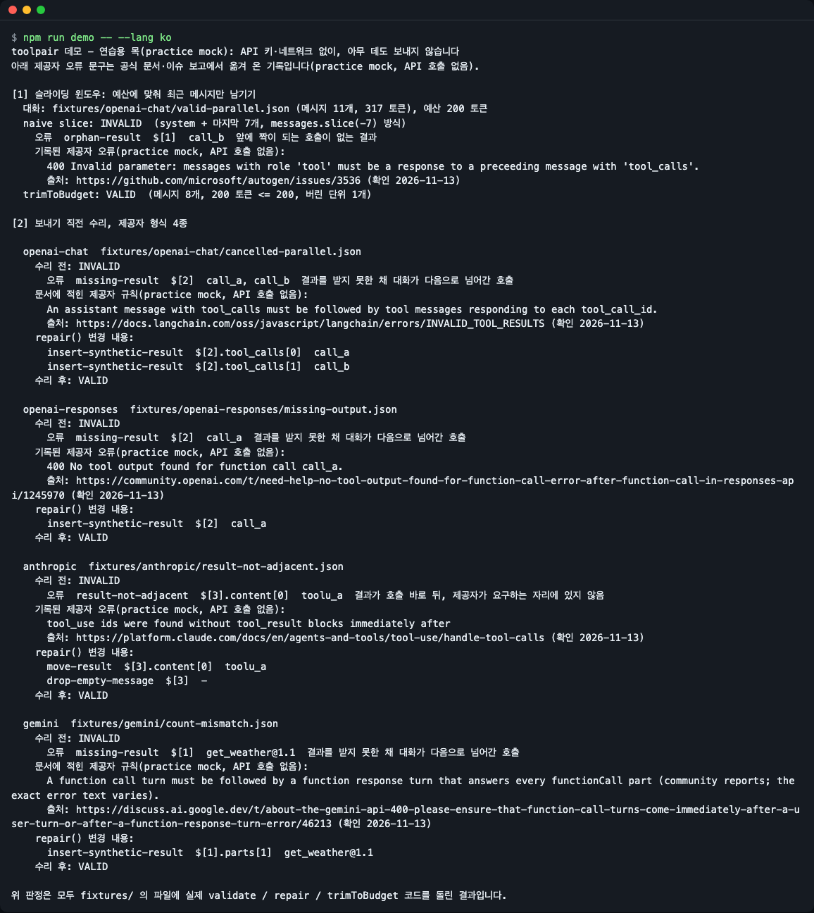
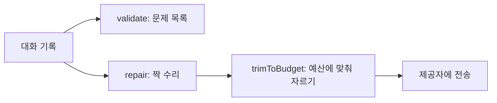
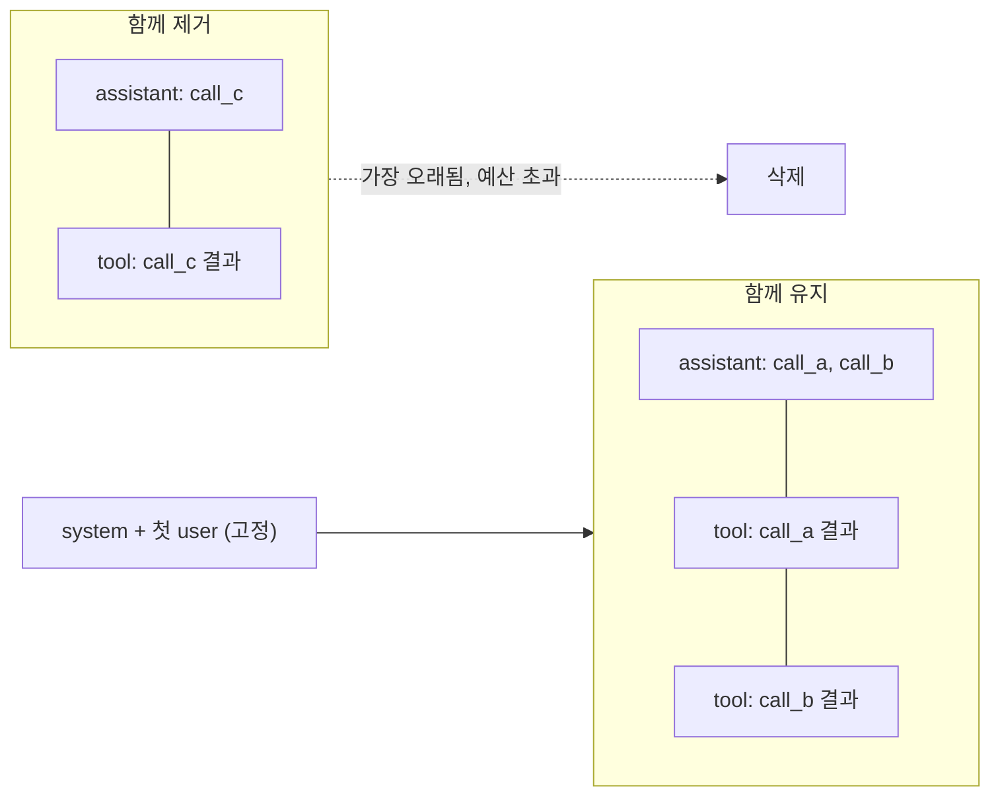
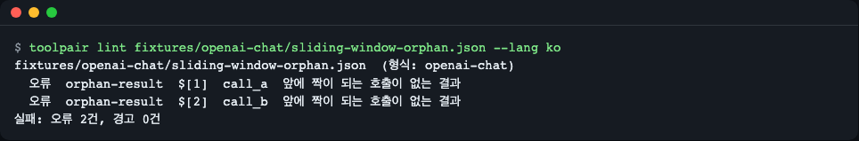
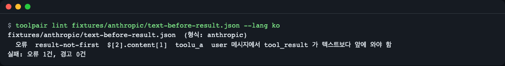
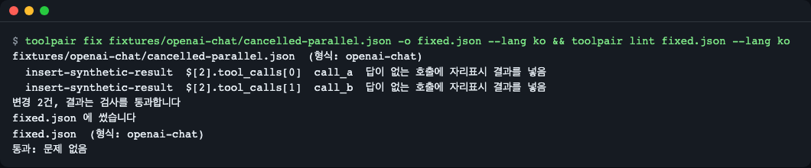
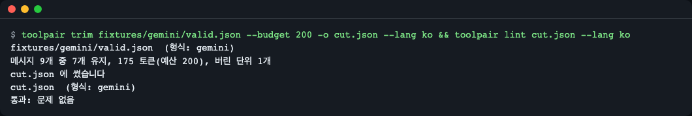

# toolpair

[English](README.md) | **한국어**

LLM 대화 기록을 검증·수리하고 토큰 예산에 맞춰 자르면서, 모든 도구 호출이 도구 결과와 짝을 유지하게 합니다. OpenAI Chat Completions, OpenAI Responses, Anthropic Messages, Gemini 기록을 읽고, 런타임 의존성이 없으며, 타입을 포함한 ESM + CommonJS 빌드와 저장된 대화용 작은 `toolpair` CLI를 제공합니다.

대화 기록을 슬라이딩 윈도우로 자르거나, 요약하거나, 호출 도중 취소하거나, DB에서 다시 불러오면 도구 호출이 결과를 잃거나(또는 결과가 호출을 잃고) 제공자가 400 오류로 요청을 거부합니다. 보내기 직전에 한 줄을 실행하면 기록을 검사하고 고치고, 호출·결과 짝을 쪼개지 않은 채 토큰 예산에 맞춰 자릅니다.



*오프라인 데모(연습용 목 모드, API 키 없음): 같은 200 토큰 예산에서 단순 `slice`는 INVALID, `trimToBudget`은 VALID 기록을 만듭니다.*

## 무엇을 고치나

도구 호출과 결과의 짝이 맞지 않으면 제공자가 HTTP 400으로 답합니다. 검색해서 이 문서에 오셨을 법한 오류 문구입니다(인용한 페이지에서 그대로 옮김, 2026-11-13 확인):

| 형식 | 오류 문구 | 출처 |
|---|---|---|
| OpenAI Chat | `Invalid parameter: messages with role 'tool' must be a response to a preceeding message with 'tool_calls'.` | [autogen#3536](https://github.com/microsoft/autogen/issues/3536) |
| OpenAI Responses | `No tool output found for function call call_a.` | [OpenAI 포럼](https://community.openai.com/t/need-help-no-tool-output-found-for-function-call-error-after-function-call-in-responses-api/1245970) |
| Anthropic | `tool_use ids were found without tool_result blocks immediately after` | [Anthropic 문서](https://platform.claude.com/docs/en/agents-and-tools/tool-use/handle-tool-calls) |
| Gemini | `Please ensure that function call turns come immediately after a user turn or after a function response turn` | [Google 포럼](https://discuss.ai.google.dev/t/about-the-gemini-api-400-please-ensure-that-function-call-turns-come-immediately-after-a-user-turn-or-after-a-function-response-turn-error/46213) |

## 설치

GitHub에서 바로(지금 가능, `prepare` 스크립트가 `dist/`를 만듭니다):

```bash
npm install github:LeeGyeongPil/toolpair
```

npm 레지스트리에 게시된 뒤에는:

```bash
npm install toolpair
```

Node.js 20 이상이 필요합니다(`brew install node` 또는 `nvm install 20`, 최소 리눅스 이미지에서는 Node.js와 `git`을 설치). 핵심 기능은 브라우저에서도 동작합니다. 런타임 의존성은 없습니다.

## 빠르게 시작하기

```js
import { validate, repair, trimToBudget } from "toolpair";

// A chat where the user cancelled while two parallel tool calls were running.
const history = [
  { role: "user", content: "Weather in Seoul and Busan?" },
  {
    role: "assistant",
    content: null,
    tool_calls: [
      { id: "call_a", type: "function", function: { name: "get_weather", arguments: '{"city":"Seoul"}' } },
      { id: "call_b", type: "function", function: { name: "get_weather", arguments: '{"city":"Busan"}' } },
    ],
  },
  { role: "user", content: "Never mind, tell me a fun fact instead." },
];

console.log(validate(history).issues);
const { messages, changes } = repair(history);
console.log(changes);
console.log(validate(messages).ok);
console.log(trimToBudget(messages, { budget: 8000 }).messages.length);
```

```text
[
  {
    rule: 'missing-result',
    severity: 'error',
    path: '$[1]',
    ids: [ 'call_a', 'call_b' ]
  }
]
[
  {
    op: 'insert-synthetic-result',
    path: '$[1].tool_calls[0]',
    ids: [ 'call_a' ]
  },
  {
    op: 'insert-synthetic-result',
    path: '$[1].tool_calls[1]',
    ids: [ 'call_b' ]
  }
]
true
5
```

- `validate`가 오류 하나를 찾았습니다: 메시지 `$[1]`의 두 호출이 결과를 받지 못했습니다.
- `repair`가 호출마다 자리표시 결과를 넣었고, 이제 검증을 통과합니다.
- `trimToBudget`은 8000 토큰이면 충분하므로 5개 메시지를 모두 남겼습니다.

CommonJS도 됩니다: `const { repair } = require("toolpair");`. 같은 함수가 요청 본문 전체(`{ messages }`, `{ input }`, `{ contents }`)도 받고 같은 모양으로 돌려줍니다.

## 핵심 개념



1. **짝.** 도구 호출(`tool_calls`, `function_call`, `tool_use`, `functionCall`)은 같은 id의 도구 결과로 답해야 합니다. 결과가 놓일 자리는 제공자마다 다릅니다: OpenAI Chat·Responses는 별도 결과 메시지, Anthropic·Gemini는 바로 다음 user 메시지 안(Anthropic은 텍스트보다 앞)입니다.
2. **검증(validate).** 문제마다 규칙 id, JSON 경로, 호출 id를 알려 줍니다. 입력은 바꾸지 않습니다.
3. **수리(repair).** 결정적이고 멱등입니다: `repair(repair(x))`는 더 바꾸지 않습니다. 입력을 변경하지 않으며, 모든 변경은 넘겨준 원래 입력 안의 경로와 함께 나열됩니다.
4. **자르기(trim).** 먼저 수리한 뒤 예산에 들어가는 최근 메시지를 남깁니다. 호출과 그 결과는 함께 남기거나 함께 버리고, system 메시지와 첫 user 메시지는 고정하며, 남긴 구간은 진짜 user 턴에서 시작합니다. 결과는 항상 검증을 통과합니다.

`trimToBudget`이 항상 유효한 이유: 메시지 하나씩이 아니라 묶음 단위로 자르기 때문입니다.



한 묶음은 assistant 메시지 하나(호출 N개)와 그 호출에 답하는 결과 N개입니다. 예산에 묶음의 절반만 들어가면 묶음 전체를 버리므로, 결과 없는 호출도 호출 없는 결과도 남지 않습니다.

규칙 7개와 각 규칙의 근거입니다(2026-11-13 확인). "오류 문구"는 인용한 페이지에서 제공자 메시지를 찾았다는 뜻, "문서 규칙"은 규칙은 적혀 있지만 정확한 오류 문구는 확인하지 못했다는 뜻, "커뮤니티 보고"는 포럼 보고만 있다는 뜻입니다.

| 규칙 | 의미 | 근거 |
|---|---|---|
| `orphan-result` | 앞에 짝이 되는 호출이 없는 결과 | 4개 형식 모두 오류 문구: [OpenAI Chat](https://github.com/microsoft/autogen/issues/3536), [Responses](https://community.openai.com/t/issue-with-new-responses-api-400-no-tool-call-found-for-function-call-output-with-call-id/1142327), [Anthropic](https://github.com/AstrBotDevs/AstrBot/pull/8350), [Gemini](https://discuss.ai.google.dev/t/gemini-api-tool-calling-constraint-is-breaking-workflows-and-driving-users-to-competitors/184406) |
| `missing-result` | 결과를 받지 못한 채 대화가 다음으로 넘어간 호출 | 오류 문구: [Responses](https://community.openai.com/t/need-help-no-tool-output-found-for-function-call-error-after-function-call-in-responses-api/1245970), [Anthropic](https://platform.claude.com/docs/en/agents-and-tools/tool-use/handle-tool-calls). 문서 규칙만: [OpenAI Chat](https://docs.langchain.com/oss/javascript/langchain/errors/INVALID_TOOL_RESULTS), [Gemini](https://discuss.ai.google.dev/t/about-the-gemini-api-400-please-ensure-that-function-call-turns-come-immediately-after-a-user-turn-or-after-a-function-response-turn-error/46213)(정확한 문구는 제각각) |
| `open-call-at-end` | 마지막 호출이 아직 열려 있음(경고: 실행 중일 수 있음) | toolpair 자체 점검, 제공자 문구 없음 |
| `duplicate-call-id` | 두 호출이 같은 id를 씀 | toolpair 자체 점검, 제공자 문구 없음 |
| `result-not-adjacent` | 결과가 제공자가 기대하는 자리에서 떨어져 저장됨 | Anthropic은 오류 문구([문서](https://platform.claude.com/docs/en/agents-and-tools/tool-use/handle-tool-calls)). Gemini의 같은 턴 개수 일치는 커뮤니티 보고([포럼](https://discuss.ai.google.dev/t/about-the-gemini-api-400-please-ensure-that-function-call-turns-come-immediately-after-a-user-turn-or-after-a-function-response-turn-error/46213)), Responses는 마찬가지로 커뮤니티 보고라 경고로만 다룸 |
| `result-not-first` | Anthropic: user 메시지에서 `tool_result`가 텍스트보다 앞에 와야 함 | 문서 규칙([문서](https://platform.claude.com/docs/en/agents-and-tools/tool-use/handle-tool-calls)) |
| `empty-message` | 내용이 남지 않은 메시지(예: thinking 블록만 남음) | toolpair 자체 점검, 제공자 문구 없음 |

근거가 "toolpair 자체 점검"인 규칙은 기록을 모호하지 않게 유지하기 위한 것이며, 기록된 제공자 오류가 아닙니다.

## API

모든 함수는 배열 또는 요청 본문 객체를 받고 같은 모양으로 돌려줍니다. `format`은 `"openai-chat" | "openai-responses" | "anthropic" | "gemini" | "auto"`(기본 `auto`)입니다.

| 이름 | 하는 일 | 주요 인자 | 반환 |
|---|---|---|---|
| `detectFormat(input)` | 제공자 형식 판별 | 배열 또는 요청 본문 | `Format` |
| `validate(input, opts?)` | 문제 목록, 아무것도 바꾸지 않음 | `opts.format` | `{ format, ok, issues }`; `ok`는 error 수준 문제가 있을 때만 false; 문제는 `{ rule, severity, path, ids }` |
| `repair(input, opts?)` | 짝을 결정적으로 수리 | `format`, `missingResults: "synthesize" \| "drop-call"`, `openCallAtEnd: "keep" \| "cancel"`, `syntheticResult`(문자열 또는 `(call) => string`) | `{ messages, format, changes }`; 변경은 `{ op, path, ids }` |
| `trimToBudget(input, opts)` | 수리 뒤 짝을 쪼개지 않고 토큰 예산에 맞춰 자르기 | `budget`(필수), `countTokens(message)`, `pin: { system, firstUser }`, `format` | `{ messages, format, tokens, droppedUnits, overBudget, changes }` |
| `defaultCountTokens(message)` | 근사 토큰 수(`ceil(JSON 길이 / 4)`) | 메시지 하나 | 숫자 |
| `RULES` | 규칙 id 7개 | | `RuleId[]` |
| `DEFAULT_SYNTHETIC_RESULT` | 기본 자리표시 문구 | | `"[cancelled] no result was recorded"` |
| `ToolpairError` | 아래 예외들의 부모 | | |
| `InvalidInputError` | 입력이 배열·객체가 아니거나 옵션이 잘못됨 | | |
| `UnknownFormatError` | 배열·객체지만 제공자 형식을 알 수 없음 | | |

변경 연산: `drop-orphan-result`, `insert-synthetic-result`, `move-result`, `drop-call`, `drop-empty-message`, `merge-same-role`. 자리표시 결과는 Anthropic에서 오류로 표시(`is_error: true`)되고 Gemini에서는 `error` 키를 씁니다.

## 사용법

### 보내기 직전에 실행

[`examples/before-send.ts`](examples/before-send.ts)는 취소된 병렬 호출을 수리하고 결과를 자릅니다(API는 호출하지 않습니다):

```bash
node --import tsx examples/before-send.ts
```

이 저장소를 clone해 `npm install`을 한 뒤 실행하세요(게시된 패키지가 아니라 소스를 가져옵니다). 배열 대신 요청 본문을 넘기면 결과의 `messages`는 본문 객체(다른 필드는 그대로)이므로, 보내기 전에 `.messages`를 꺼내 쓰세요.

```ts
const { messages: fixed } = repair(history);               // 1) 짝 수리
const { messages } = trimToBudget(fixed, { budget: 8000 }); // 2) 예산에 맞춤
// await openai.chat.completions.create({ model, messages, tools });
```

정확한 예산이 필요하면 `countTokens`로 실제 토크나이저를 넘기세요. 내장 계산은 근사치입니다(한국어·코드는 적게 나옵니다).

### CLI로 저장된 대화 점검

```bash
npx toolpair lint conversation.json
```



*`lint`는 문제마다 규칙, JSON 경로, 호출 id를 출력하고 요약합니다. 오류를 찾으면 종료 코드 1입니다.*



*규칙은 제공자별입니다: 여기서는 Anthropic user 메시지에서 텍스트가 `tool_result`보다 앞에 있습니다.*

종료 코드: `0` 정상, `1` 문제 발견(`lint`), `2` 사용법·입력 오류. `--json`은 기계가 읽는 보고서를 출력하고 `-`는 표준 입력을 읽습니다.

### CLI로 수리·자르기



*`fix`는 수리한 JSON을 쓰고 모든 변경을 나열합니다. 결과를 lint하면 통과합니다.*



*`trim`은 수리한 뒤 예산에 맞춰 자르며 결과는 lint를 통과합니다.*

`-o` 없이 실행하면 `fix`와 `trim`은 JSON을 표준 출력, 보고서를 표준 오류로 보냅니다.

### 정책

```js
repair(history, { missingResults: "drop-call" });                 // 가짜 결과 대신 답 없는 호출을 지움
repair(history, { openCallAtEnd: "cancel" });                     // 맨 끝의 열린 호출도 닫음
repair(history, { syntheticResult: ({ name }) => `${name}: cancelled` });
```

기본적으로 맨 끝의 열린 호출은 그대로 두고(실행 중일 수 있음) `open-call-at-end` 경고로 알립니다.

## 설정

| 설정 | 위치 | 의미 |
|---|---|---|
| `--lang en\|ko` | CLI | 화면 언어. 우선순위: `--lang`, `TOOLPAIR_LANG`, `LC_ALL`, `LC_MESSAGES`, `LANG`. `ko`로 시작하지 않으면 영어. |
| `TOOLPAIR_LANG` | 환경 변수 | `--lang`과 같음 |
| `--format F` | CLI | `auto`(기본), `openai-chat`, `openai-responses`, `anthropic`, `gemini` |
| `--missing P` | `fix` | `synthesize`(기본) 또는 `drop-call` |
| `--open-call P` | `fix` | `keep`(기본) 또는 `cancel` |
| `--budget N` | `trim` | 토큰 예산 |

규칙 id, JSON 경로, `VALID` / `INVALID`는 두 언어에서 같습니다. 라이브러리 결과는 번역된 글이 아니라 데이터입니다.

## 오프라인으로 해 보기

```bash
git clone https://github.com/LeeGyeongPil/toolpair && cd toolpair
npm install
npm run demo -- --lang ko
```

데모는 연습용 목(mock) 모드입니다: API 키가 필요 없고 아무 데도 보내지 않습니다. `fixtures/`에 기록된 대화에 실제 `validate`, `repair`, `trimToBudget` 코드를 돌립니다. 흉내 내는 부분은 "제공자가 뭐라고 답할까"뿐이며, 그 문구는 문서와 이슈 보고에서 옮겨 와 출처 URL·확인 날짜와 함께 `fixtures/provider-errors.json`에 있습니다. 실제 제공자 호출은 하지 않습니다.

## 다른 도구와 비교

아래 내용은 2026-11-13에 적힌 버전으로 직접 돌려 본 결과입니다. 이후 대안이 바뀌었을 수 있습니다.

- [tool-history-guard](https://www.npmjs.com/package/tool-history-guard) 0.1.1: ESM `import`가 실패했습니다(`ERR_PACKAGE_PATH_NOT_EXPORTED`, `require` 조건만 있음). Responses·Gemini 기록은 유효하다고 보고했고, 자리표시 결과를 넣지 않으며 자르기도 없습니다. OpenAI·Anthropic 모양 배열을 CommonJS에서 빨리 점검만 하면 된다면 이쪽이 낫습니다.
- [ai-sdk-heal](https://www.npmjs.com/package/ai-sdk-heal) 0.2.0: Vercel AI SDK `ModelMessage[]`용이고 AI SDK 고유 규칙을 다룹니다. `content: null`인 원시 OpenAI 메시지를 넣으면 `Cannot read properties of null` 예외가 났습니다. AI SDK 안에서만 작업한다면 이쪽이 낫습니다.
- AI SDK [`pruneMessages`](https://ai-sdk.dev/docs/reference/ai-sdk-ui/prune-messages)(`ai` 7.0.171): 도구 호출·결과 묶음을 함께 지우지만 검증·보고서·토큰 예산이 없습니다.
- LangChain [`trimMessages`](https://js.langchain.com/docs/how_to/trim_messages/)(`@langchain/core` 1.4.0): 기본값 `maxTokens=40`에서 프로브가 고아 `tool` 메시지 2개를 남겼습니다. `startOn: "human"`이면 피하지만 `system, human`만 남았습니다. LangChain 메시지 객체를 쓴다면 이쪽을 고려하세요.

toolpair의 차이는 원시 제공자 형식 4종을 한 규칙 체계로 다루고, 자리표시 결과를 넣고, 호출·결과 짝을 쪼개지 않으며 토큰 예산에 맞춰 자르고, ESM + CommonJS와 CLI를 함께 제공한다는 점입니다.

## 언제 쓰나

- 잘 맞는 경우: 제공자 SDK를 직접 부르고(또는 프레임워크를 섞어 쓰고), 기록을 보내기 전에 자르거나 요약하거나 취소하거나 다시 불러올 때. 저장된 대화 JSON을 CI에서 점검할 때도 좋습니다.
- 다른 도구가 나을 수 있는 경우: Vercel AI SDK 자체 메시지 타입 안에서만 작업한다면 [AI SDK](https://ai-sdk.dev/), 대화 메모리나 요약이 필요하면 쓰는 프레임워크의 메모리 기능을 보세요. toolpair는 짝을 고치고 자르기만 하며 요약하지 않습니다.

한계: toolpair는 로컬 배열만 봅니다. 사고 서명(thought signature) 복구, 도구 스키마·인자 검증, 서버 쪽 상태 확인은 하지 않습니다. Responses API에서 `previous_response_id`나 `conversation`을 쓰면 서버 쪽 호출에 대한 출력이 고아로 취급되지 않도록 요청 본문 전체를 넘기세요. 호출 id가 중복되면 먼저 나온 호출을 남깁니다. Responses는 `function_call`·`custom_tool_call` 짝만 확인합니다. Gemini 응답 턴을 새로 만들 때는 role `user`(현재 문서 기준)를 쓰며, 일부 환경에서는 `function`이 필요하다는 보고가 있습니다.

## 버전·호환성

- [유의적 버전(SemVer)](https://semver.org/lang/ko/)을 따릅니다. 0.x 동안은 마이너 버전에서 API가 바뀔 수 있고, 바뀌면 [CHANGELOG.md](CHANGELOG.md)에 적습니다.
- 현재 버전: 0.1.1. Node.js 20 이상; CI 워크플로가 Node 20과 22를 돌립니다.

## 개발

```bash
npm install
npm run typecheck
npm test            # 빌드 후 177개 테스트 실행
npm run smoke:pack  # 묶은 tarball을 임시 폴더에 설치해 import 확인
```

## 라이선스

MIT.
