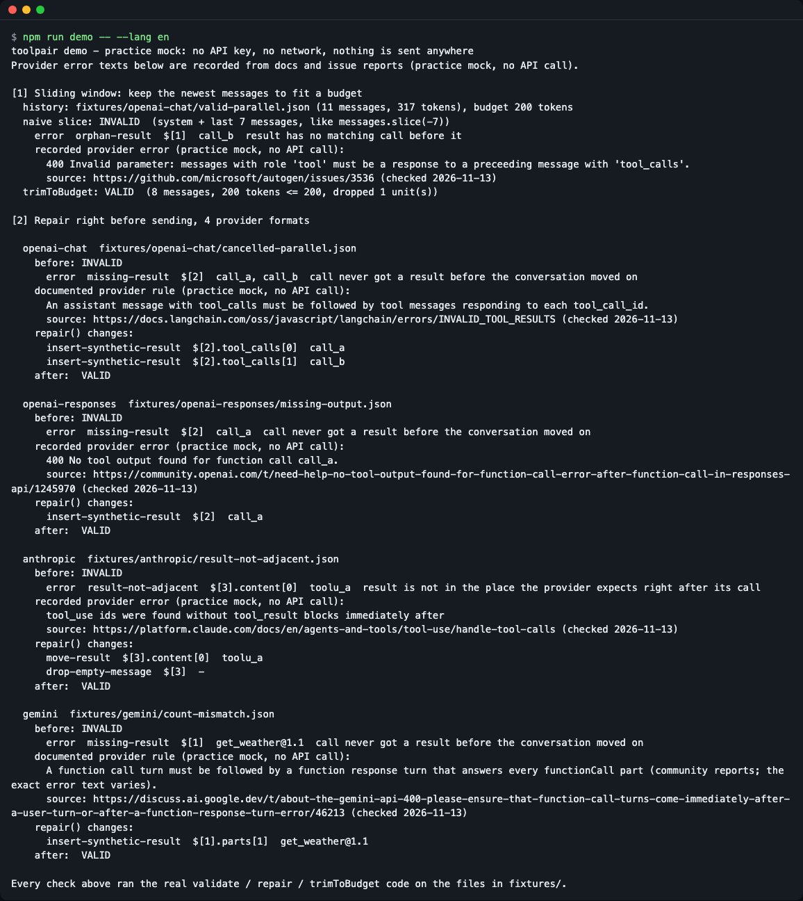
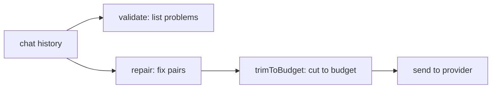
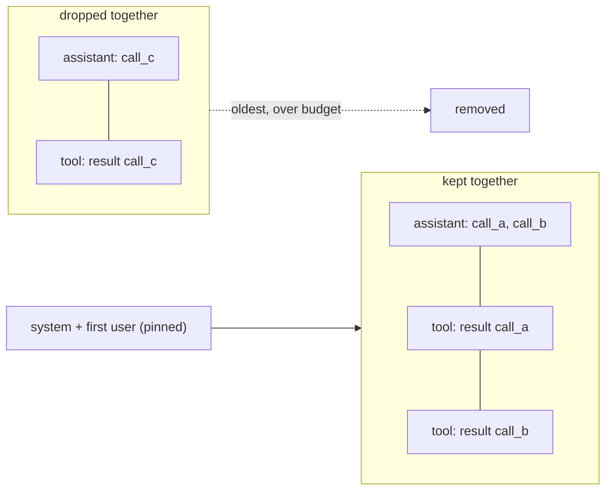
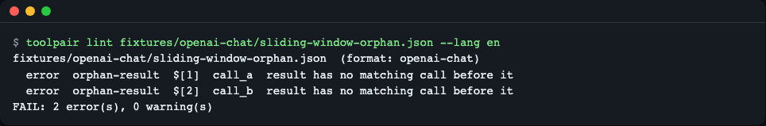
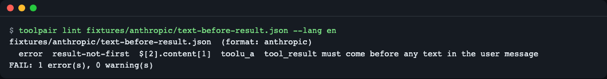
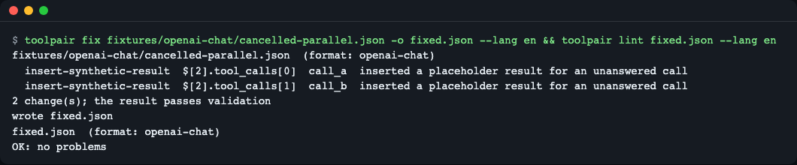
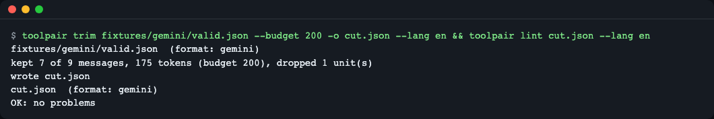

# toolpair

**English** | [한국어](README.ko.md)

Validate, repair and budget-trim LLM chat histories so every tool call keeps its tool result. It reads OpenAI Chat Completions, OpenAI Responses, Anthropic Messages and Gemini histories, has zero runtime dependencies, and ships ESM + CommonJS builds with types, plus a small `toolpair` CLI for saved conversations.

When a chat history is cut by a sliding window, summarized, cancelled mid-call or reloaded from a database, a tool call can lose its result (or a result can lose its call). The provider then rejects the request with a 400 error. Run one line right before sending and the history is checked, fixed and trimmed to a token budget without splitting a call/result pair.



*The offline demo (practice mock, no API key): the same 200-token budget produces an INVALID history with a plain `slice` and a VALID one with `trimToBudget`.*

## What it fixes

A provider answers with HTTP 400 when a tool call and its result do not line up. These are the texts you may have searched for (copied from the cited pages, checked 2026-11-13):

| Format | Error text | Source |
|---|---|---|
| OpenAI Chat | `Invalid parameter: messages with role 'tool' must be a response to a preceeding message with 'tool_calls'.` | [autogen#3536](https://github.com/microsoft/autogen/issues/3536) |
| OpenAI Responses | `No tool output found for function call call_a.` | [OpenAI forum](https://community.openai.com/t/need-help-no-tool-output-found-for-function-call-error-after-function-call-in-responses-api/1245970) |
| Anthropic | `tool_use ids were found without tool_result blocks immediately after` | [Anthropic docs](https://platform.claude.com/docs/en/agents-and-tools/tool-use/handle-tool-calls) |
| Gemini | `Please ensure that function call turns come immediately after a user turn or after a function response turn` | [Google forum](https://discuss.ai.google.dev/t/about-the-gemini-api-400-please-ensure-that-function-call-turns-come-immediately-after-a-user-turn-or-after-a-function-response-turn-error/46213) |

## Install

From GitHub (works now; the `prepare` script builds `dist/`):

```bash
npm install github:LeeGyeongPil/toolpair
```

From the npm registry, once the package is published there:

```bash
npm install toolpair
```

Requires Node.js 20+ (`brew install node`, or `nvm install 20`; on a minimal Linux image install Node.js and `git`). The core also runs in browsers. There are no runtime dependencies.

## Quick start

```js
import { validate, repair, trimToBudget } from "toolpair";

// A chat where the user cancelled while two parallel tool calls were running.
const history = [
  { role: "user", content: "Weather in Seoul and Busan?" },
  {
    role: "assistant",
    content: null,
    tool_calls: [
      { id: "call_a", type: "function", function: { name: "get_weather", arguments: '{"city":"Seoul"}' } },
      { id: "call_b", type: "function", function: { name: "get_weather", arguments: '{"city":"Busan"}' } },
    ],
  },
  { role: "user", content: "Never mind, tell me a fun fact instead." },
];

console.log(validate(history).issues);
const { messages, changes } = repair(history);
console.log(changes);
console.log(validate(messages).ok);
console.log(trimToBudget(messages, { budget: 8000 }).messages.length);
```

```text
[
  {
    rule: 'missing-result',
    severity: 'error',
    path: '$[1]',
    ids: [ 'call_a', 'call_b' ]
  }
]
[
  {
    op: 'insert-synthetic-result',
    path: '$[1].tool_calls[0]',
    ids: [ 'call_a' ]
  },
  {
    op: 'insert-synthetic-result',
    path: '$[1].tool_calls[1]',
    ids: [ 'call_b' ]
  }
]
true
5
```

- `validate` found one error: the two calls in message `$[1]` never got a result.
- `repair` inserted a placeholder result for each call, and the result now validates.
- `trimToBudget` kept all 5 messages because 8000 tokens is plenty.

CommonJS works too: `const { repair } = require("toolpair");`. The same functions accept the whole request body (`{ messages }`, `{ input }` or `{ contents }`) and return the same shape.

## Core concepts



1. **Pair.** A tool call (`tool_calls`, `function_call`, `tool_use`, `functionCall`) must be answered by a tool result with the same id. Providers differ in where the result must sit: OpenAI Chat and Responses use separate result messages; Anthropic and Gemini put results in the next user message (Anthropic: before any text).
2. **Validate.** Reports each problem with a rule id, a JSON path and the call ids. It never changes the input.
3. **Repair.** Deterministic and idempotent: `repair(repair(x))` makes no further changes. The input is not mutated, and every change is listed with its path in your original input.
4. **Trim.** Repairs first, then keeps the newest messages that fit the budget. A call and its results are kept or dropped together, system messages and the first user message are pinned, and the kept window opens on a real user turn. The output always validates.

Why `trimToBudget` stays valid: it cuts in units, never in single messages.



A unit is one assistant message with its N calls plus the N results that answer them. A budget that fits half a unit drops the whole unit, so no call is left without its result and no result without its call.

The seven rules, with where each one comes from (checked 2026-11-13). "Error text" means the provider's message was found on the cited page; "documented rule" means the rule is written down but no exact error text was confirmed; "community report" means forum reports only.

| Rule | Meaning | Basis |
|---|---|---|
| `orphan-result` | A result has no matching call before it | Error text for all four formats: [OpenAI Chat](https://github.com/microsoft/autogen/issues/3536), [Responses](https://community.openai.com/t/issue-with-new-responses-api-400-no-tool-call-found-for-function-call-output-with-call-id/1142327), [Anthropic](https://github.com/AstrBotDevs/AstrBot/pull/8350), [Gemini](https://discuss.ai.google.dev/t/gemini-api-tool-calling-constraint-is-breaking-workflows-and-driving-users-to-competitors/184406) |
| `missing-result` | A call never got a result before the conversation moved on | Error text: [Responses](https://community.openai.com/t/need-help-no-tool-output-found-for-function-call-error-after-function-call-in-responses-api/1245970), [Anthropic](https://platform.claude.com/docs/en/agents-and-tools/tool-use/handle-tool-calls). Documented rule only: [OpenAI Chat](https://docs.langchain.com/oss/javascript/langchain/errors/INVALID_TOOL_RESULTS), [Gemini](https://discuss.ai.google.dev/t/about-the-gemini-api-400-please-ensure-that-function-call-turns-come-immediately-after-a-user-turn-or-after-a-function-response-turn-error/46213) (exact text varies) |
| `open-call-at-end` | The last call is still open (warning: it may be running) | toolpair's own check, no provider text |
| `duplicate-call-id` | Two calls use the same id | toolpair's own check, no provider text |
| `result-not-adjacent` | A result is stored away from where the provider expects it | Error text for Anthropic ([docs](https://platform.claude.com/docs/en/agents-and-tools/tool-use/handle-tool-calls)). The Gemini same-turn count match is a community report ([forum](https://discuss.ai.google.dev/t/about-the-gemini-api-400-please-ensure-that-function-call-turns-come-immediately-after-a-user-turn-or-after-a-function-response-turn-error/46213)); for Responses this is only a warning because it is a community report too |
| `result-not-first` | Anthropic: `tool_result` must come before text in the user message | Documented rule ([docs](https://platform.claude.com/docs/en/agents-and-tools/tool-use/handle-tool-calls)) |
| `empty-message` | A message with no content left (for example only thinking blocks) | toolpair's own check, no provider text |

Where the basis is "toolpair's own check" the rule keeps the history unambiguous; it is not a recorded provider error.

## API

All functions take a bare array or a request body object and return the same shape. `format` is `"openai-chat" | "openai-responses" | "anthropic" | "gemini" | "auto"` (default `auto`).

| Name | What it does | Main arguments | Returns |
|---|---|---|---|
| `detectFormat(input)` | Guess the provider format | array or request body | `Format` |
| `validate(input, opts?)` | List problems, change nothing | `opts.format` | `{ format, ok, issues }`; `ok` is false only if there is an error-level issue; each issue is `{ rule, severity, path, ids }` |
| `repair(input, opts?)` | Fix pairs deterministically | `format`, `missingResults: "synthesize" \| "drop-call"`, `openCallAtEnd: "keep" \| "cancel"`, `syntheticResult` (string or `(call) => string`) | `{ messages, format, changes }`; each change is `{ op, path, ids }` |
| `trimToBudget(input, opts)` | Repair, then cut to a token budget without splitting pairs | `budget` (required), `countTokens(message)`, `pin: { system, firstUser }`, `format` | `{ messages, format, tokens, droppedUnits, overBudget, changes }` |
| `defaultCountTokens(message)` | Approximate token count (`ceil(JSON length / 4)`) | one message | number |
| `RULES` | The seven rule ids | | `RuleId[]` |
| `DEFAULT_SYNTHETIC_RESULT` | Default placeholder text | | `"[cancelled] no result was recorded"` |
| `ToolpairError` | Parent of the errors below | | |
| `InvalidInputError` | Input is not an array or object, or an option is invalid | | |
| `UnknownFormatError` | Array or object whose provider format cannot be told | | |

Change operations: `drop-orphan-result`, `insert-synthetic-result`, `move-result`, `drop-call`, `drop-empty-message`, `merge-same-role`. The placeholder result is marked as an error for Anthropic (`is_error: true`) and uses an `error` key for Gemini.

## Usage

### Run right before sending

[`examples/before-send.ts`](examples/before-send.ts) repairs a cancelled parallel call and trims the result (no API is called):

```bash
node --import tsx examples/before-send.ts
```

Run it from a clone of this repository after `npm install` (it imports the sources, not the published package). If you pass a request body instead of a bare array, the returned `messages` is the body object (with its other fields kept), so read `.messages` from it before sending.

```ts
const { messages: fixed } = repair(history);               // 1) fix pairs
const { messages } = trimToBudget(fixed, { budget: 8000 }); // 2) fit the budget
// await openai.chat.completions.create({ model, messages, tools });
```

Use a real tokenizer for exact budgets by passing `countTokens`. The built-in count is an approximation (it undercounts Korean text and code).

### Lint a saved conversation from the CLI

```bash
npx toolpair lint conversation.json
```



*`lint` prints each problem with its rule, JSON path and call id, then a summary. It exits 1 when it finds errors.*



*Rules are provider-specific: here an Anthropic user message puts text before `tool_result`.*

Exit codes: `0` ok, `1` problems found (`lint`), `2` usage or input error. `--json` prints a machine-readable report, and `-` reads standard input.

### Fix and trim from the CLI



*`fix` writes the repaired JSON and lists every change; linting the output passes.*



*`trim` repairs, cuts to the budget and the result lints clean.*

Without `-o`, `fix` and `trim` write the JSON to standard output and the report to standard error.

### Policies

```js
repair(history, { missingResults: "drop-call" });                 // drop unanswered calls instead of faking results
repair(history, { openCallAtEnd: "cancel" });                     // also close a call still open at the end
repair(history, { syntheticResult: ({ name }) => `${name}: cancelled` });
```

By default a call still open at the very end is kept (it may be running) and reported as the `open-call-at-end` warning.

## Settings

| Setting | Where | Meaning |
|---|---|---|
| `--lang en\|ko` | CLI | Display language. Priority: `--lang`, then `TOOLPAIR_LANG`, then `LC_ALL`, `LC_MESSAGES`, `LANG`. Anything not starting with `ko` is English. |
| `TOOLPAIR_LANG` | environment | Same as `--lang` |
| `--format F` | CLI | `auto` (default), `openai-chat`, `openai-responses`, `anthropic`, `gemini` |
| `--missing P` | `fix` | `synthesize` (default) or `drop-call` |
| `--open-call P` | `fix` | `keep` (default) or `cancel` |
| `--budget N` | `trim` | Token budget |

Rule ids, JSON paths and `VALID` / `INVALID` stay the same in both languages. Library results are data, not translated text.

## Try it offline

```bash
git clone https://github.com/LeeGyeongPil/toolpair && cd toolpair
npm install
npm run demo -- --lang en
```

The demo is a practice mock: it needs no API key and sends nothing anywhere. It runs the real `validate`, `repair` and `trimToBudget` code on recorded histories in `fixtures/`. The only simulated part is "what would the provider say": those texts are recorded from documentation and issue reports, each with its source URL and check date (`fixtures/provider-errors.json`). A real provider call is not made.

## Compared with

Facts below come from probes run on 2026-11-13 with the versions named; the alternatives may have changed since.

- [tool-history-guard](https://www.npmjs.com/package/tool-history-guard) 0.1.1: ESM `import` failed (`ERR_PACKAGE_PATH_NOT_EXPORTED`, only a `require` condition). Responses and Gemini histories were reported valid. It does not insert placeholder results and has no trimming. Pick it if you only need a quick CommonJS check on OpenAI/Anthropic-shaped arrays.
- [ai-sdk-heal](https://www.npmjs.com/package/ai-sdk-heal) 0.2.0: works on Vercel AI SDK `ModelMessage[]` and handles AI SDK specific rules; a raw OpenAI message with `content: null` threw `Cannot read properties of null`. It is the better choice if you stay inside the AI SDK.
- AI SDK [`pruneMessages`](https://ai-sdk.dev/docs/reference/ai-sdk-ui/prune-messages) (`ai` 7.0.171): removes tool call/result groups together, but has no validation, report or token budget.
- LangChain [`trimMessages`](https://js.langchain.com/docs/how_to/trim_messages/) (`@langchain/core` 1.4.0): with the default `maxTokens=40` the probe kept two orphan `tool` messages. `startOn: "human"` avoids that but kept only `system, human`. Pick it if you work with LangChain message objects.

toolpair differs in covering four raw provider formats with one rule set, inserting placeholder results, trimming to a token budget without splitting a call/result pair, and shipping ESM + CommonJS with a CLI.

## When to use it

- Good fit: you call provider SDKs directly (or mix frameworks), and your history is cut, summarized, cancelled or reloaded before it is sent. Also good for checking saved conversation JSON in CI.
- Another tool may fit better: you stay inside the Vercel AI SDK's own message types, see [AI SDK](https://ai-sdk.dev/); you want conversation memory or summarization, see your framework's memory features. toolpair only fixes and trims pairs; it does not summarize.

Limits: toolpair only looks at the local array. It does not recover thought signatures, validate tool schemas or arguments, or check server-side state. If you use `previous_response_id` or `conversation` with the Responses API, pass the whole request body so outputs for server-side calls are not treated as orphans. On a duplicate call id the first call is kept. For Responses only `function_call` and `custom_tool_call` pairs are checked. When toolpair creates a Gemini response turn it uses the role `user` (current docs); some setups have reported needing `function`.

## Versions and compatibility

- Follows [Semantic Versioning](https://semver.org/). While 0.x, minor versions may change the API; changes are listed in [CHANGELOG.md](CHANGELOG.md).
- Current version: 0.1.2. Node.js 20+; the CI workflow runs Node 20, 22 and 24 (npm 10 and npm 11).

## Development

```bash
npm install
npm run typecheck
npm test            # builds, then runs 178 tests
npm run smoke:pack  # installs the packed tarball in a temp folder and imports it
```

## License

MIT.
